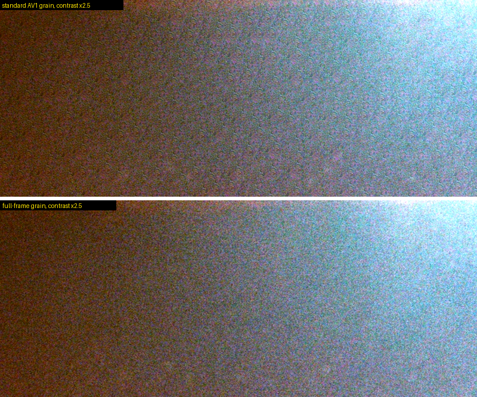
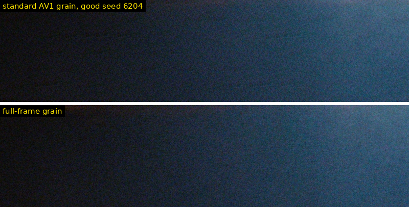
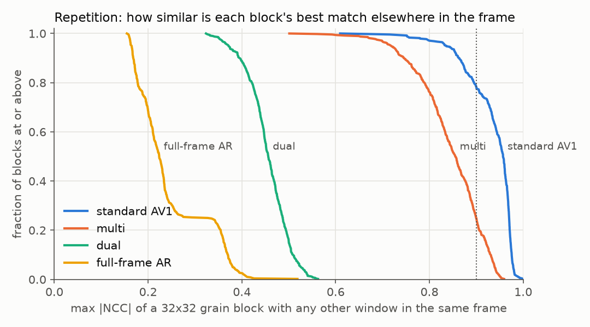
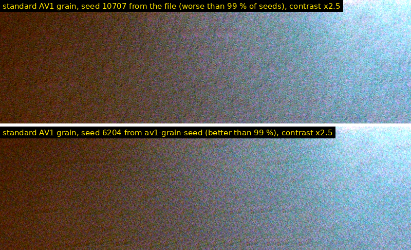

# av1-fullgrain

Full-frame AV1 film grain: the grain an AV1 file signals, drawn over the
**whole frame** instead of tiled from one small grain patch. It has four
parts:

- **A dav1d fork** (this repository): [dav1d](https://code.videolan.org/videolan/dav1d)
  1.5.4, the AV1 decoder used by ffmpeg, mpv and most players, with
  full-frame grain synthesis. Its library is a drop-in replacement for
  `libdav1d`.
- **A browser player** ([wasm/](wasm/README.md)): the browser decodes a
  grain-free copy of the clip; the grain is drawn with WebGPU (or the fork's
  grain code in WebAssembly), bit-identical to the C code.
- **A seed fixer** ([av1-grain-seed](#fix-grain-seeds-in-existing-files)):
  for the standard, tiled grain that every other decoder draws. It replaces
  unlucky grain seeds in existing files (IVF, OBU, MP4, Matroska) by
  rewriting 16 bits per frame header. Blotchy repeats disappear in every
  player, TVs and hardware decoders included. The grain stays tiled.
- **Later, a GPU path for mpv** (libplacebo): not written yet.

Encoders such as SVT-AV1 and libaom remove film grain before encoding and
send a short grain description instead: an auto-regressive (AR) noise model
and an intensity curve. The decoder synthesises the grain from that
description. The AV1 specification builds it as follows:

- one **82x73** grain template is generated per frame;
- the frame is covered with 32x32 blocks, each copied from one of only **256
  positions** in that template.

The same few thousand grain samples therefore appear hundreds of times in
every frame. On grainy films this shows as a faint repeating texture: diagonal
streaks, a 32-pixel grid, the same speckle in many places. This fork runs the
same signalled AR model over the full frame instead. The grain keeps the
statistics the encoder signalled, with no repeats and no block seams.

The upstream dav1d README is [README.dav1d.md](README.dav1d.md).

## Comparison

A frame from *Black Swan* (stage haze), 1080p 10-bit AV1 with film grain. Both
halves decode the same bitstream with the same grain parameters; only the
synthesis differs. This encode happens to use an unlucky grain seed: its
82x73 template has a visible blotch, and standard AV1 tiles it across the
whole frame. Full-frame synthesis doesn't use a template, so the seed can't
create a pattern.

At 1:1:


Contrast stretched 2.5x, where the repeating tile is easy to see:



Zoomed 2x:


Even with a typical seed, the standard tiling repeats; it's just less obvious
by eye. Below is a second Black Swan stage frame encoded with an ordinary seed.
The grain on its own (decoded with grain minus decoded without), contrast
stretched:


Repetition map. For one 32x32 block of grain (blue), every place elsewhere in
the same frame where the grain matches it with a correlation of 0.85 or more
is outlined in orange:


### Even a good seed tiles

A better seed removes the blotch, not the tiling. Below is the bad-seed frame
from the top of this section with the seed that
[`av1-grain-seed`](#fix-grain-seeds-in-existing-files) puts there instead:
6204, which rates better than 99 % of all seeds under this frame's grain
parameters. Standard AV1 grain with that good seed, against full-frame grain,
at 1:1:



Contrast stretched 2.5x:


The good seed gives an even texture, and that is its problem: it is more
even than film grain. Measured on the grain alone (same parameters, a flat
grey frame):

- **Still tiled.** Every 32x32 block of the good-seed frame has a near-copy
  elsewhere in the same frame: median best match 0.98, 100 % of blocks above
  0.9, exactly as with the bad seed (0.97, 100 %). Full-frame grain: 0.20,
  0 %.
- **Too uniform.** Grain strength in 16x16 windows varies by 4.1 % (standard
  deviation) with the good seed, against 5.7 % for full-frame grain, which
  follows the random variation of the signalled AR model (the bad seed:
  6.8 %). Coarse structure at 16 px is 42 % below the model's.


- **Correlated at a distance.** The 2D autocorrelation of full-frame grain
  is the single short peak of the AR model. Tiled grain adds a halo of
  correlations out to about 30 px, each the offset between two blocks cut
  from overlapping parts of the one template, and bands every 32 rows from
  the 32-row block stripes:


A seed can only choose which template gets tiled. Natural, random grain needs
the full-frame synthesis.

## Numbers

Measured on four films (two 1080p 10-bit, one 1080p 8-bit, one 4K 10-bit),
8 frames each (4 for the 4K film):

| | standard AV1 | full-frame |
|---|---:|---:|
| 32x32 grain blocks with a near-copy (correlation > 0.9) elsewhere in the same frame | 92-97 % | **0 %** |
| median best match of a block anywhere else in the frame (independent noise: 0.17-0.37) | 0.95-0.97 | **0.17-0.37** |
| per-frame spectrum error against the signalled AR model (dB RMS) | 1.3 | **0.07-0.11** |
| variance ripple with a 32-px period | ±9-11 % | **±1-2 %** (noise floor) |
| grain CPU time vs standard, x86-64 AVX2 (1080p / 4K) | 1x | **2.7x / 2.1x** |
| whole-decode CPU vs standard (1080p / 4K) | | **+49 % / +32 %** |




The spectrum chart shows a single frame. The standard synthesis inherits the
random error of its one small template, so every frame's grain spectrum is
off by about 1.3 dB, differently in each frame. Full-frame grain follows the
signalled model.

Cost was measured with `--threads 4` on a Ryzen 5 9600X under load. The
spread over 5 rounds was 2.3-4.0x at 1080p and 2.1-2.35x at 4K; within each
round the ratio is steadier than the absolute times.


A 4K 10-bit film decodes at 43 fps on 4 threads, against 57 fps for
upstream. On Apple Silicon the NEON code produces identical output (checked
in CI and under qemu), but its speed has not been measured on real hardware
yet; CI prints timings for `macos-14`.

## How it works

**Inputs, all as signalled.** The same 2048-entry Gaussian table and shifts,
the same AR coefficients with the same integer rounding and clipping, the
same piecewise-linear intensity scaling, and the same chroma-from-luma AR
term.

**Full-frame mode.**
- White noise is a stateless hash of the frame seed and the pixel position.
- The AR recursion runs over the whole frame.
- To keep dav1d's parallel row tasks, each band of 4x32 rows restarts the
  recursion 16 rows above itself. Because the noise is a hash, the warm-up
  rows reproduce the rows above, and the restart is invisible: at most 0.7 %
  of the grain RMS in luma.
- SIMD: the AR filter's left-neighbour taps make every row a serial
  dependency chain. 16 rows are therefore computed in lockstep in a skewed
  memory layout, one vector lane per row, where every filter tap is a single
  vector load. This is done in AVX2 on x86-64 and NEON on arm64.
- Results are bit-identical to the C code on both architectures.

**Other modes** come from the same study. They keep the 32x32 blocks but mix
more grain:
- `dual` adds two block layers on grids offset by 16 px.
- `multi` uses 16 templates per frame and per-block sign and 180° rotation.

`dual` removes the strong repeats at about the same cost as `full`. `multi`
is cheaper and only removes exact copies. `full` is the default.

## Install

> **This is not a conformant AV1 decoder.** The AV1 spec defines the grain
> pixel by pixel. With this fork, decoded AV1 *with film grain* differs from
> every other decoder, although the grain is statistically the same. Video
> without film grain is decoded exactly like upstream dav1d. Use it for
> watching, not for conformance tests or anything that compares checksums.
> `DAV1D_GRAIN_MODE=standard` gives standard grain at any time.

The library has the same name, version and API as dav1d 1.5.4
(`libdav1d.so.7` / `libdav1d.7.dylib`). Installed in place of the system
copy, it is picked up by ffmpeg, mpv and everything else that links the
system dav1d. Apps that bundle their own dav1d are not affected: IINA,
mpv.app, VLC and web browsers.

### Arch Linux

This replaces the `dav1d` package system-wide (`provides=dav1d`,
`conflicts=dav1d`):

```sh
git clone https://github.com/divergentnn/av1-fullgrain.git
cd av1-fullgrain/packaging/arch
makepkg -si
```

Back to stock: `sudo pacman -S dav1d`. The PKGBUILD runs the test suite in
`check()`. For a different default mode, use
`DAV1D_FULLGRAIN_MODE=dual makepkg -si`.

### Other Linux

```sh
git clone https://github.com/divergentnn/av1-fullgrain.git
cd av1-fullgrain
meson setup build --buildtype=release --prefix=/usr/local
ninja -C build
sudo ninja -C build install
sudo ldconfig
ldd "$(command -v ffmpeg)" | grep dav1d    # should now point into /usr/local
```

You need `meson`, `ninja` and, on x86, `nasm`. On Debian and Ubuntu,
`/usr/local/lib` is searched before the system library. On distros where it
is not (Fedora, Arch), add the install libdir to `/etc/ld.so.conf.d/` or use
your distribution's packaging. To undo, run
`sudo ninja -C build uninstall && sudo ldconfig`.

**Without installing anything.** Build as above, skip the install, and start
mpv through the wrapper:

```sh
contrib/mpv/mpv-fullgrain FILE.mkv           # or: mpv-fullgrain standard|dual|multi FILE
```

### macOS (Homebrew)

```sh
git clone https://github.com/divergentnn/av1-fullgrain.git
cd av1-fullgrain
packaging/macos/install.sh
```

The script:
- installs `meson` and `ninja` with Homebrew (`nasm` on Intel);
- builds the fork and runs the tests;
- swaps the `libdav1d.7.dylib` inside Homebrew's `dav1d` keg (keeping the
  original as `libdav1d.7.dylib.stock`) and re-signs it.

Homebrew's ffmpeg and mpv (`brew install mpv`) then use the fork. To undo,
run `packaging/macos/uninstall.sh` or `brew reinstall dav1d`.

`brew upgrade dav1d` also puts the stock library back; run `install.sh`
again afterwards, or `brew pin dav1d`. The script refuses to replace a
Homebrew dav1d other than 1.5.x unless you run it with `FORCE=1`.

**Without touching Homebrew.** Build with `meson setup build && ninja -C build`,
then use `contrib/mpv/mpv-fullgrain FILE`, which sets `DYLD_LIBRARY_PATH` for
Homebrew's mpv.

### mpv settings (Linux and macOS)

The fork only matters when dav1d decodes the AV1.

- **Grain on the GPU: handled.** mpv's `gpu-next` renderer normally asks the
  decoder to leave grain out and draws standard AV1 grain itself
  (`vd-lavc-film-grain=auto`). The fork still applies full-frame grain in that
  case and hides the grain parameters, so nothing is drawn twice. This is the
  `grain_force` option, on by default; `DAV1D_GRAIN_FORCE=0` restores the
  upstream behaviour.
- **Hardware decoding: needs one line.** With hardware decoding, dav1d isn't
  used at all. That applies to Macs with M3 or later and to most recent PC
  GPUs, if mpv's `hwdec` is on. Keep AV1 in software and everything else in
  hardware with this line in `~/.config/mpv/mpv.conf`:

```ini
# AV1 in software (dav1d); every other codec keeps hardware decoding
hwdec-codecs=h264,vc1,hevc,vp8,vp9,prores,prores_raw,ffv1,dpx
```

That list is mpv 0.41's default without `av1`. The file is also at
[contrib/mpv/mpv.conf](contrib/mpv/mpv.conf).

**Live A/B.** Load [contrib/mpv/grain-mode.lua](contrib/mpv/grain-mode.lua)
(the wrapper does this; with a system install, set `DAV1D_GRAIN_MODE_FILE`
to any writable path before starting mpv):
- `g` cycles standard / dual / full / multi;
- `b` is a blind toggle between standard and full, shown only as A/B;
- `B` reveals which was which.

### In the browser

The browser's own AV1 decoder (WebCodecs, hardware where the device has it) decodes a **grain-free copy** of the clip.
The grain is drawn on top from the clip's grain parameters:
- by WebGPU compute shaders;
- or, without WebGPU, by this fork's grain code compiled to WebAssembly.

Full-frame and standard grain are both **bit-identical** to the C code. This was checked on NVIDIA, AMD and Apple
GPUs and in SwiftShader, through the browser's decoder end to end.

- **Making the copy:** `build/tools/av1grain strip IN.ivf OUT.ivf PARAMS.json`, or
  `tools/av1grain_mp4.py IN.mp4 OUT.mp4 PARAMS.json`. It rewrites only the frame headers' grain syntax (to
  `apply_grain = 0`), using dav1d's own parser, and records the grain of every picture.
- **Speed:** grain costs 3.2 ms per 4K frame on an RTX 3090 and 7.2 ms on an Apple GPU (Chrome on macOS). Decoding is
  the browser's: about 120 fps at 4K for Chrome's software dav1d.
- **Requirements:** a browser that decodes AV1 (Chrome, Edge, Firefox; Safari only on M3 Macs and later). WebGPU, or a
  cross-origin isolated page for the WebAssembly threads.
- **Used by:** [flipcomp](https://github.com/divergentnn/flipcomp) (private), my comparison viewer.

See [wasm/README.md](wasm/README.md).

## Options

| | |
|---|---|
| `DAV1D_GRAIN_MODE=full\|standard\|dual\|multi\|standard_c` | override the default mode at runtime; `standard` = conformant AV1 grain |
| `DAV1D_GRAIN_MODE_FILE=path` | re-read the mode from this file while decoding (every 100 ms) |
| `DAV1D_GRAIN_STATS=1` | print grain CPU time per frame when the decoder closes |
| `DAV1D_GRAIN_SIMD=0` | use the C paths (testing) |
| `DAV1D_GRAIN_TEMPLATES`, `DAV1D_GRAIN_WARMUP`, `DAV1D_GRAIN_BANDS` | tuning for multi/dual (16) and full (16 rows, 4 bands) |
| meson `-Dgrain_mode_default=full\|standard\|dual\|multi` | built-in default (`full` in this fork) |
| `DAV1D_GRAIN_FORCE=0\|1`, meson `-Dgrain_force=true\|false` | apply the variant even when the player turned grain off, hiding the grain parameters from it (default on; off = upstream behaviour) |

## Caveats

- **Non-conformant on purpose** (see above). Anything that applies AV1 grain
  outside this fork still shows standard grain: hardware decoders, mpv's
  `gpu-next` grain, browsers (except with this repository's browser player).
- **Software decoding of AV1 costs CPU.** Full-frame grain adds about 30-50 %
  to dav1d's decode time.
- **x86-64 uses AVX2; arm64 uses NEON.** Other CPUs use portable C, which is
  correct but several times slower for `full`; `dual` is the lighter choice
  there.
- **Statistics, not pixels.** The grain matches the signalled statistics,
  not the grain of the original film: that information was never in the
  file.

## Fix grain seeds in existing files

`av1-grain-seed` improves the standard grain of AV1 files that already exist,
for every decoder: players, TVs, hardware decoders, browsers, upstream dav1d.
Each AV1 frame header with film grain carries its own 16-bit `grain_seed`
(also when the other grain parameters are reused from a reference frame).
The tool replaces unlucky seeds by rewriting only those 16 bits. Nothing is
re-encoded or decoded. The file keeps its size and every other byte, so
audio, subtitles, chapters and the container stay exactly as they were.

```sh
ninja -C build tools/av1fg/av1-grain-seed      # built with the fork (meson -Dav1fg=true, the default)
av1-grain-seed film.mkv                        # rate the seeds; writes nothing
av1-grain-seed -o fixed.mkv film.mkv           # a copy with new seeds
av1-grain-seed --in-place film.mkv             # patch the file itself (after a full parse)
av1-grain-seed --only-bad -o fixed.mkv film.mkv   # change only the seeds rated bad
```

Formats: IVF, AV1 OBU streams (Section 5 and Annex B), MP4/MOV (also
fragmented) and Matroska/WebM. Matroska CRC-32 elements are updated.
Laced, compressed or encrypted AV1 tracks are refused. The tool is plain C11
with no dependencies, and runs on Linux, macOS and Windows.

The bad-seed frame from the [comparison](#comparison) above, before and after
(standard grain in both, contrast stretched 2.5x):



That frame comes from a test clip with deliberately bad seeds. Encoders pick
their seeds blindly, though. Below is the same scene encoded with the
encoder's own seeds: its worst frame (23), whose seed rates worse than 99 % of
all seeds, before and after.


**How a seed is rated.** The tool predicts, without rendering, what the
standard synthesis puts on screen. It builds the seed's luma and chroma
templates and its 32x32 block offsets for the frame's size, exactly as the
spec does. From those it computes the frame's grain statistics:
- blotches: the variance of 4, 8 and 16 px box means, relative to the grain
  variance;
- voids and clumps: the variation of the local variance in 8 and 16 px
  windows, for luma and for chroma;
- neighbouring blocks cut at the same offset.

The badness is a weighted sum of z-scores against 64 reference seeds under
the same grain parameters (32 when nearly every frame has its own parameters).
The reference seeds span the range of seed quality evenly, so a seed's rank
among them is its percentile among all seeds.

**Checks on the rating.**
- On 2048 seeds per parameter set, these predictions match the statistics
  of frames that dav1d actually rendered: Spearman 0.93-0.99 for the grain
  parameters of three films and one aomenc test vector. The template's
  statistics alone reach only 0.6-0.7, because the block offsets decide
  which parts of the template get repeated.
- The README's bad seed rates worse than 99 % of seeds. The seeds of the
  2026-10-07 blind tests rank in the order the viewer judged them:
  deliberately bad templates at a median percentile of 80, encoder seeds at
  49, and optimised seeds at 7.
- The spectrum error behind the 1.3 dB in [Numbers](#numbers) (the
  template's spectrum against the AR model's) is not a useful seed measure.
  Measured on the template, it barely varies between seeds (0.91 ± 0.05 dB)
  and doesn't track the rendered blotches (Spearman 0.06).

**Degenerate seeds.** For one seed in about 2,000 at 1080p (one in 1,000 at
4K), one 32-row stripe's block-offset generator starts at state 0. All 60
blocks of that stripe (120 at 4K) then repeat the same 32x32 crop. Real
encodes contain them: 89 frames of a 2-hour 1080p SVT-AV1 encode, 230 frames
of a 2.5-hour 4K one. The tool never picks these seeds, or seeds with a
constant chroma template.

**Seed policy.**
- **Pool.** 2,048 seeds that rate well under the grain parameters of 11
  files (SVT-AV1, libaom and rav1e; 720p to 4K). They are spread over the
  65,535-step cycle of the grain random number generator. Neighbouring
  generator states share most of their template, so good seeds come in
  clusters, and the pool keeps at most 64 per 2,048 states.
- **Per frame.** Each displayed frame tries the next 15 seeds of a fixed
  walk through the pool, and keeps the best one under its own grain
  parameters and frame size. It skips seeds whose luma or chroma template
  would share more than half its samples with one of the previous 3 frames'
  templates.
- **No repeats.** The walk visits every pool seed once per 136 frames, so
  every frame gets a new seed and no seed returns within 5.7 s at 24 fps.
- **Determinism.** The rating uses only integer arithmetic and IEEE
  add/multiply/divide/sqrt in a fixed order. The same input gives the same
  output, byte for byte, on Linux, macOS and Windows (checked in CI).

On two full-length SVT-AV1 encodes, a 2-hour 1080p film and a 2.5-hour 4K
film, 10 % and 18 % of the encoder's seeds rate worse than 90 % of all seeds.
After the fix none do. The new seeds sit at a median percentile of 1.6 in
both films, with the 90th percentile at 3.6 and 6.4.

**Checks on the edit.**
- The parser's grain parameters match libdav1d's for every output picture.
- Patched files decode to identical pictures with grain off.
- With grain on, a patched file decodes exactly to the original picture
  plus the grain of the new seed (checked with `dav1d_apply_grain`).
- Covered: libaom (tiles, tile groups, error resilience with frame ids,
  superres, switch frames, forward key frames, no order hints, 4:2:0, 4:2:2,
  4:4:4, monochrome, 8 and 10 bit), rav1e, and SVT-AV1 including overlay
  frames. `update_grain = 0` and `show_existing_frame` are tested in every
  container, plus redundant frame headers.
- The written file differs from the input only in the seed fields and the
  Matroska CRC-32s.

**Speed.** Only headers are read. Times are with 8 threads on a busy
Ryzen 5 9600X:

| film | frames | grain parameter sets | total | parse | rating | copy |
|---|---:|---:|---:|---:|---:|---:|
| 2.5 h, 4K, 19.7 GB Matroska | 220,000 | 218,908 | 5.6 min | 37 s | 4.9 min | 8 s |
| 2 h, 1080p, 5.6 GB Matroska | 170,000 | 169,668 | 3.6 min | 18 s | 3.3 min | 1 s |
| 1.8 h, 1080p, 3.5 GB Matroska | 156,000 | 1,393 | 67 s | 2 s | 62 s | 2 s |

- **Parse:** with a warm cache. The 4K file takes 41 s from a cold cache.
- **Rating:** 16 seeds per frame, plus 64 reference seeds per parameter set
  (32 when nearly every frame has its own). Encoders that estimate the grain
  per frame (SVT-AV1 through ffmpeg) produce a new parameter set for almost
  every frame.
- **Copy:** the `-o` copy is one sequential pass, with the edits applied on
  the way. The times above stream to `/dev/null`; writing to disk adds its
  write time.

**Limits.**
- Streams with several operating points: only operating point 0 is parsed
  (as dav1d does by default), so seeds of layers outside it are left alone.
- Large-scale-tile streams are not supported.
- The fix makes standard grain as good as one tile can be. It stays tiled
  ([see above](#even-a-good-seed-tiles)).

## Testing

`tests/fullgrain/run.sh build/tools/dav1d [upstream/dav1d]` checks:
- every mode against committed hashes, which are identical on x86-64 and
  arm64;
- the SIMD paths against the C paths;
- given an upstream dav1d 1.5.4 build, that `standard` is md5-identical to it.

The test streams are synthetic, made with aomenc's film-grain test vectors.
[CI](.github/workflows/fullgrain.yml) runs this on Linux x86-64 and macOS
arm64.

`meson test -C build --suite av1fg --suite av1fg-dav1d` tests
`av1-grain-seed` on these streams and on small synthetic fixtures in every
container (`tools/av1fg/tests`). It checks the parser against libdav1d,
the edits by decoding, the bytes that change, the Matroska CRC-32s, and
that the output md5s are the same on every platform. CI runs it on Linux,
macOS and Windows (MSVC).

## Licence and credits

dav1d is © VideoLAN and dav1d authors, under the BSD 2-Clause licence
([COPYING](COPYING)). This fork's changes are released under the same
licence. The film-grain test streams are synthetic. The comparison images
are small crops from *Black Swan* (2010), used here for illustration.
